# 🛠️ Mechanical CAD & Robotics Engineering Portfolio

A comprehensive portfolio of parametric 3D CAD models, robotics chassis, kinematic mechanisms, and DFM-optimized assemblies designed in **SolidWorks**, **Onshape**, and **Autodesk Fusion 360**.

> **Engineering Pipeline:** Fully constrained parametric sketches → Multi-body kinematic assemblies (revolute, prismatic, cylindrical joints) → Finite Element Analysis (FEA) stress validation → Design for Manufacturing (DFM) & ISO 286 tolerance stack-up.

---

## 🔬 Engineering Highlights

- **Parametric Robustness:** Fully dimensioned and constrained sketches with automated design tables, equations, and modular component hierarchy.
- **Kinematic Mechanisms:** Multi-axis articulated robotic joints, planetary gear reducers, differential drive chassis, and linkage mechanisms with motion study validation.
- **DFM & Prototyping:** Optimized for FDM/SLA additive manufacturing (proper draft angles, overhang management, press-fit / clearance tolerances ISO 286 H7/g6) and CNC machining.
- **FEA & Structural Simulation:** Von Mises stress, displacement, and factor-of-safety (FOS > 2.5) verification under peak dynamic payloads.

---

## 📐 Interactive CAD Inspection Showcase

All models feature interactive animated SVG telemetry HUD overlays (live laser surface scanning, coordinate datums, tolerance indicators, and rotating inspection reticles):

| Model View | Description | Animated Source |
| :--- | :--- | :--- |
| **Robotics Assembly 01** | Primary Base Articulation & Mount Flange | [Inspect SVG](Images/Screenshot%202026-10-29%20075349.svg) |
| **Robotics Assembly 02** | Actuator Housing & Bearing Retention | [Inspect SVG](Images/Screenshot%202026-10-29%20075436.svg) |
| **Robotics Assembly 03** | Structural Linkage & Weight-Reduction Pockets | [Inspect SVG](Images/Screenshot%202026-10-29%20075454.svg) |
| **Robotics Assembly 04** | Forearm Joint & Servo Coupler | [Inspect SVG](Images/Screenshot%202026-10-29%20075503.svg) |
| **Robotics Assembly 05** | Precision End-Effector Mechanism | [Inspect SVG](Images/Screenshot%202026-10-29%20075623.svg) |
| **Robotics Assembly 06** | Gearbox Enclosure & Thermal Ribs | [Inspect SVG](Images/Screenshot%202026-10-29%20075631.svg) |
| **Robotics Assembly 07** | Sensor Bracket & LiDAR Mast Assembly | [Inspect SVG](Images/Screenshot%202026-10-29%20075646.svg) |
| **Robotics Assembly 08** | Differential Chassis & Wheel Hub Assembly | [Inspect SVG](Images/Screenshot%202026-10-29%20075730.svg) |
| **Robotics Assembly 09-18** | Complete Modular Mechanism Gallery | [View All](Images/) |

---

## 👤 Author
**Arun Gupta**  
Robotics & Automation Engineer  
🔗 GitHub: [@Arun069gupta](https://github.com/Arun069gupta)

